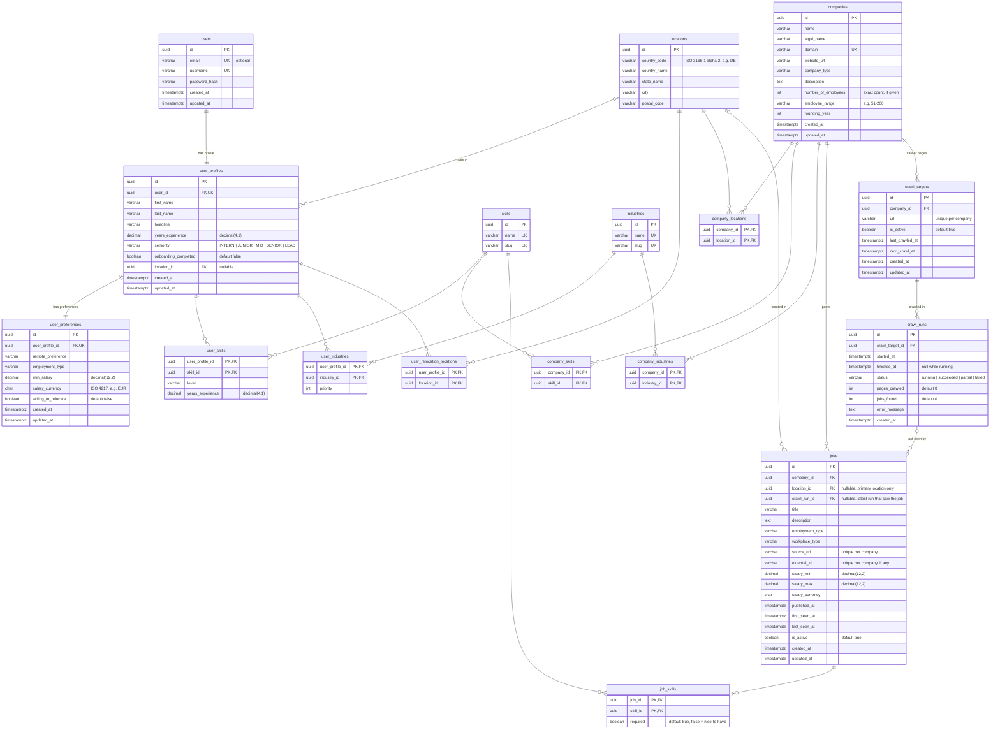

# Database schema diagram

ER diagram of the JobScraper database, written in
[Mermaid](https://mermaid.js.org/syntax/entityRelationshipDiagram.html).
GitHub renders it directly; elsewhere, paste the block into
https://mermaid.live.

The source of truth is [`db-schema-v1.dbml`](db-schema-v1.dbml), which also
explains the tables, the crawling flow and the on-delete behaviour. Keep this
diagram in sync with it.

Relation markers: `||--||` is one-to-one, `||--o{` is one-to-many,
`|o--o{` is an optional (nullable) one-to-many.

