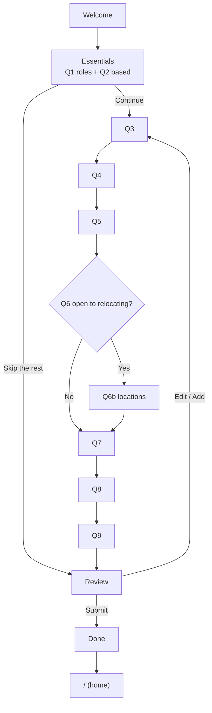

Flow (Mermaid)

Skip for now on Q3–Q9 moves to the next question (answer stays "Not set").
Edit / Add on the Review screen jumps back to that question, then returns to Review.

Flow (ASCII backup)

/onboarding:

  Welcome ──► Essentials (Q1 roles + Q2 based) ──► Q3 ──► Q4 ──► Q5 ──► Q6
                      │                                              │
                      │                                    Yes ──► Q6b ──┐
                      │                                    No  ──────────┤
                      │                                                  ▼
                      │                                       Q7 ──► Q8 ──► Q9
                      │                                                  │
                      └──────── "Skip the rest" ──────────┐              │
                                                          ▼              ▼
                                                        Review ◄─────────┘
                                                          │ Submit
                                                          ▼
                                                    Done ──► / (home)

  "Skip for now" on Q3–Q9 moves to the next question (answer stays "Not set").
  Review: [ Edit / Add ] jumps back to a question, then returns to Review.

Required: Q1 (roles) and Q2 (based), both on the Essentials screen.
Everything else is optional.
"Onboarding done" is set on Submit once the required answers are present.

0  WELCOME
   ┌───────────────────────────────────────────┐
   │  Hi {firstName} 👋                         │
   │  Let's tailor your job matches.            │
   │  Only 2 questions are required ·           │
   │  the rest is optional · ~1 min             │
   │           ( Let's start ↵ )                │
   └───────────────────────────────────────────┘

── ESSENTIALS (required) ────────────
1  What roles are you looking for?            → tag input (1-3)
   Mix fields freely, e.g. Fullstack developer
   [ Frontend Developer ✕ ][ UI Engineer ✕ ] [type + Enter…]

2  Where are you based?                       → searchable dropdown (from DB)
   [ ber…                        ▾ ]
     Berlin, Germany
     Bavaria, Germany

          ( Continue ↵ )      Skip the rest → Review
   (Continue is enabled once Q1 and Q2 are answered)

── JOB PREFERENCES ──────────────────────────────
3  What's your seniority level?               → single choice
   [A] Intern  [B] Junior  [C] Mid  [D] Senior  [E] Lead
                                                   Skip for now

4  Which employment types work for you?       → single choice
   [A] Full-time  [B] Part-time  [C] Contract  [D] Internship [E] Freelance
                                                   Skip for now

5  Which work setup do you prefer?            → single choice
   [A] On-site [B] Hybrid  [C] Remote
                                                   Skip for now

── RELOCATION ───────────────────────────────────
6  Are you open to relocating?                → [Y] Yes   [N] No
                                                   Skip for now

6b Which locations would you consider?        → multi-select dropdown (from DB, 0–10)
   (shown only if Q6 = Yes)
   [ mun…                        ▾ ]
     Munich, Germany
   [ Hamburg, Germany ✕ ][ Vienna, Austria ✕ ]
                                                   Skip for now

── SKILLS & EXPERIENCE ──────────────────────────
7  How many years of experience do you have?
   [ − ]   1.5   [ + ]
                                                   Skip for now

8  Which skills do you have?                  → autocomplete, at least 1
   [ ty…                         ▾ ]
     TypeScript
     TypeORM
   ─────────────────────────────────────────────
   TypeScript  ○ Beginner ○ Intermediate ● Advanced ○ Expert  ✕
   React       ○ Beginner ● Intermediate ○ Advanced ○ Expert  ✕
                                                   Skip for now

9  Which languages do you speak?              → tag input (1–5)
   [ English ✕ ][ German ✕ ] [type + Enter…]
                                                   Skip for now

── WRAP-UP ──────────────────────────────────────
10 REVIEW
   ┌───────────────────────────────────────────┐
   │ Job preferences                 [ Edit ]  │ ← Edit jumps back to that question
   │  Frontend Dev, UI Engineer · Mid          │
   │  Full-time · Remote                       │
   │ Location                        [ Edit ]  │
   │  Berlin, Germany · open to relocate:      │
   │  Hamburg, Vienna                          │
   │ Skills & experience             [ Add ]   │ ← skipped answers show "Not set"
   │  Not set                                  │
   │                                           │
   │              ( Submit ↵ )                 │
   └───────────────────────────────────────────┘
   On error: a "Couldn't save, try again" message, and the answers are kept

11 DONE
   ┌───────────────────────────────────────────┐
   │   ✓  You're all set!                      │
   │   We're finding jobs that match you.      │
   │   Complete your profile anytime in        │
   │   Settings.                               │
   │        ( Go to my dashboard → )           │
   │        redirecting in 3s…                 │
   └───────────────────────────────────────────┘
