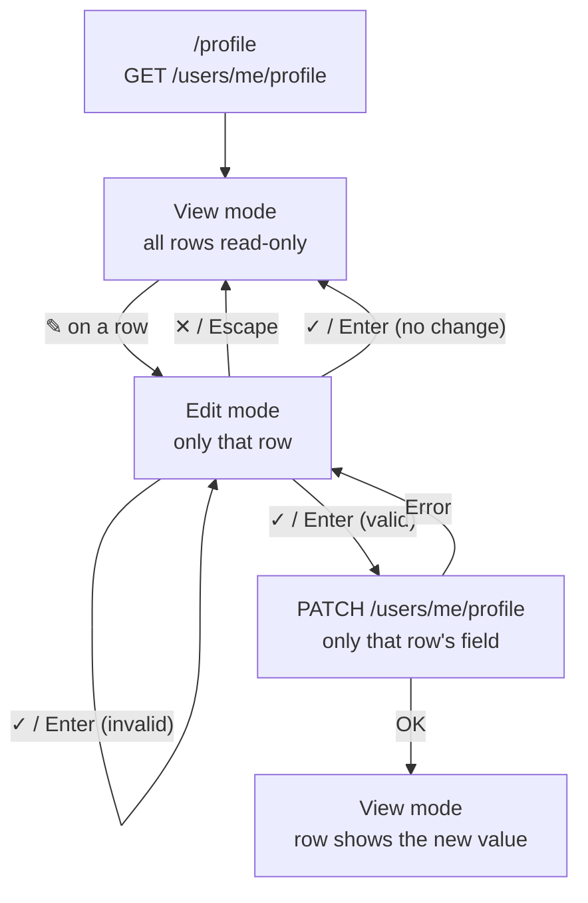

Flow (Mermaid)

✎ opens one row at a time. The other ✎ buttons are disabled until ✓ or ✕.
On error the row stays in edit mode, the draft is kept, and an error message
is shown under the field.

Flow (ASCII backup)

/profile:

  View ──[ ✎ ]──► Edit (one row) ──[ ✕ / Esc ]──► View
                       │
                       └──[ ✓ / Enter ]──► changed? ── no ──► View
                                              │
                                             yes
                                              ▼
                                           valid? ── no ──► Edit (error)
                                              │
                                             yes
                                              ▼
                                   PATCH (one field) ── error ──► Edit
                                              │                  (draft kept)
                                             OK
                                              ▼
                                   View (row shows the new value)

Required: role (headline) and based in (location), so the profile stays
complete (onboardingCompleted).
Closing or reloading the tab with an open row shows the browser's
"Leave site?" dialog.
See ADR-009.

0  VIEW MODE
   ┌──────────────────────────────────────────────┐
   │ ┌ Basic info ──────────────────────────────┐ │
   │ │ NAME          Test User                ✎ │ │
   │ │ ROLE          Frontend Developer       ✎ │ │
   │ │ SENIORITY     Mid                      ✎ │ │
   │ │ EXPERIENCE    1.5 years                ✎ │ │
   │ │ BASED IN      Berlin, DE               ✎ │ │
   │ └──────────────────────────────────────────┘ │
   │ ┌ Job preferences ─────────────────────────┐ │
   │ │ EMPLOYMENT    Full-time                ✎ │ │
   │ │ WORK SETUP    Remote                   ✎ │ │
   │ │ RELOCATE      Yes                      ✎ │ │
   │ │ PLACES        Hamburg · Vienna         ✎ │ │ ← only if relocate = Yes
   │ └──────────────────────────────────────────┘ │
   │ ┌ Skills ──────────────────────────────────┐ │
   │ │ SKILLS        TypeScript · React       ✎ │ │
   │ └──────────────────────────────────────────┘ │
   │ ┌ Industries ──────────────────────────────┐ │
   │ │ INDUSTRIES    Not set                  ✎ │ │ ← empty value: "Not set"
   │ └──────────────────────────────────────────┘ │
   └──────────────────────────────────────────────┘

── EDIT MODE (one row open, in place) ───────────

1  TEXT (name, role)
   │ ROLE          [ Frontend Developer    ]  ✓ ✕ │
   Name has two boxes: [ First name ][ Last name ].
   Empty role → "Role is required." under the field.

2  DROPDOWN (seniority, employment type, work setup, relocate)
   │ SENIORITY     [ Mid                 ▾ ]  ✓ ✕ │
   │                 Not set                      │
   │                 Intern                       │
   │                 Junior                       │
   │                 Mid  ✓                       │
   │                 Senior                       │
   │                 Lead                         │

3  NUMBER (experience)
   │ EXPERIENCE    [ 1.5 ] years              ✓ ✕ │
   Experience: 0–30, empty clears it.

4  SEARCH (based in, places, skills, industries)
   │ BASED IN      SELECTED · 1/1             ✓ ✕ │
   │               [ Berlin ✕ ]                   │
   │               [ Limit reached     ] [ + Add ] │
   Remove the chip (✕) to pick another location.
   Places: 0–4. Skills: max 50. Industries: max 10, order = priority.
   Same component as onboarding (LookupField).

── STATES ───────────────────────────────────────

5  SAVING
   │ ROLE          [ Frontend Developer    ]  ✓ ✕ │ ← ✓ and ✕ disabled

6  SAVED
   │ ROLE          Frontend Developer         ✎   │ ← row closes, shows new value

7  ERROR
   │ ROLE          [                       ]  ✓ ✕ │
   │               ⚠ Role is required.            │ ← row stays open, draft kept
                                                    (role="alert")

8  LEAVE WITH AN OPEN ROW
   Browser prompt: "Leave site? Changes you made may not be saved."
