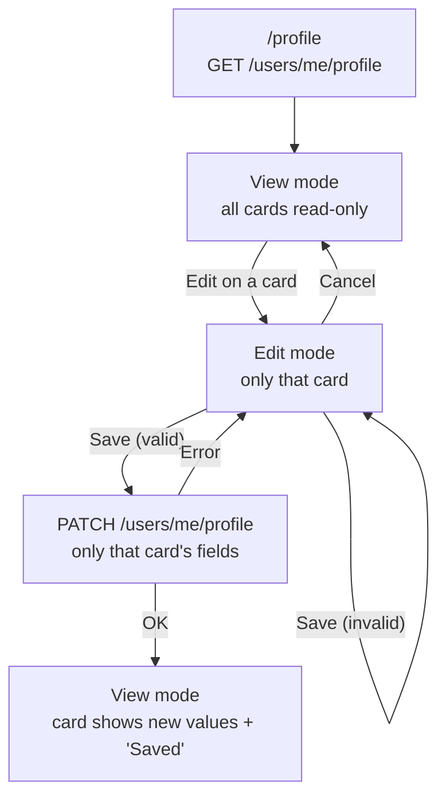

Flow (Mermaid)

Edit opens one card at a time. The other cards' Edit buttons are disabled
until Save or Cancel.
Save on error: the card stays in edit mode, the draft is kept, and an error
message is shown.

Flow (ASCII backup)

/profile:

  View ──[ Edit ]──► Edit (one card) ──[ Cancel ]──► View
                          │
                          └──[ Save ]──► valid? ── no ──► Edit (field errors)
                                           │
                                          yes
                                           ▼
                                   PATCH (one section) ── error ──► Edit
                                           │                      (draft kept)
                                          OK
                                           ▼
                                   View ("Saved ✓")

Required on Save: role (headline) and based in (location), so the profile
stays complete (onboardingCompleted).
Leaving the page with an open card shows "You have unsaved changes".
See ADR-008.

0  VIEW MODE
   ┌───────────────────────────────────────────┐
   │ Profile                                   │
   │ Last updated 23 Oct 2026                  │
   │                                           │
   │ ┌ Basic info ───────────────── [ Edit ] ┐ │
   │ │ Test User                          │ │
   │ │ Frontend Developer · Mid · 1.5 yrs    │ │
   │ │ Based in Berlin, Germany              │ │
   │ └───────────────────────────────────────┘ │
   │ ┌ Job preferences ──────────── [ Edit ] ┐ │
   │ │ Full-time · Remote                    │ │
   │ │ Min salary 50,000 EUR                 │ │
   │ │ Open to relocate: Hamburg, Vienna     │ │
   │ └───────────────────────────────────────┘ │
   │ ┌ Skills ───────────────────── [ Edit ] ┐ │
   │ │ TypeScript · Advanced                 │ │
   │ │ React · Intermediate                  │ │
   │ └───────────────────────────────────────┘ │
   │ ┌ Industries ───────────────── [ Add ]  ┐ │ ← empty section: "Add"
   │ │ Not set                               │ │   and "Not set"
   │ └───────────────────────────────────────┘ │
   └───────────────────────────────────────────┘

── EDIT MODE (one card open) ────────────────────

1  BASIC INFO
   ┌ Basic info ───────────────────────────────┐
   │ First name        Last name               │
   │ [ Test       ]  [ User              ]  │
   │ Role *                                    │
   │ [ Frontend Developer                   ]  │
   │ Seniority                                 │
   │ ( Intern )( Junior )(● Mid )( Senior )( Lead ) │
   │ Years of experience                       │
   │ [ − ]   1.5   [ + ]                       │
   │ Based in *                                │
   │ [ Berlin, Germany                   ▾ ]   │
   │                                           │
   │                    [ Cancel ]  ( Save )   │
   └───────────────────────────────────────────┘
   * required. Empty role → "Role is required" under the field.

2  JOB PREFERENCES
   ┌ Job preferences ──────────────────────────┐
   │ Employment type                           │
   │ (● Full-time )( Part-time )( Contract )   │
   │ ( Internship )( Freelance )               │
   │ Work setup                                │
   │ ( On-site )( Hybrid )(● Remote )          │
   │ Minimum salary          Currency          │
   │ [ 50000          ]      [ EUR ▾ ]         │
   │ Open to relocating?     [●] Yes  [ ] No   │
   │ Locations (0–4, shown if Yes)             │
   │ [ mun…                              ]     │
   │ [ Hamburg, Germany ✕ ][ Vienna, Austria ✕ ] │
   │                                           │
   │                    [ Cancel ]  ( Save )   │
   └───────────────────────────────────────────┘

3  SKILLS
   ┌ Skills ───────────────────────────────────┐
   │ [ ty…                               ▾ ]   │
   │ TypeScript ○ Beg ○ Int ● Adv ○ Exp   ✕   │
   │ React      ○ Beg ● Int ○ Adv ○ Exp   ✕   │
   │                                           │
   │                    [ Cancel ]  ( Save )   │
   └───────────────────────────────────────────┘
   Same component as onboarding Q8 (max 50).

4  INDUSTRIES
   ┌ Industries ───────────────────────────────┐
   │ Order = priority (first is most important)│
   │ [ fin…                              ]     │
   │ [ Software ✕ ][ Healthcare ✕ ]            │
   │                                           │
   │                    [ Cancel ]  ( Save )   │
   └───────────────────────────────────────────┘
   Same component as onboarding Q9 (max 10).

── STATES ───────────────────────────────────────

5  SAVING
   │                  [ Cancel ]  ( Saving… ) │ ← both buttons disabled

6  SAVED
   ┌ Skills ─────────────── Saved ✓ ─ [ Edit ] ┐ ← "Saved ✓" fades after 3s
   │ TypeScript                      │   (aria-live)
   └───────────────────────────────────────────┘

7  ERROR
   │ ⚠ Couldn't save, try again                │ ← card stays in edit mode,
   │                    [ Cancel ]  ( Save )   │   draft is kept (aria-live)

8  LEAVE WITH UNSAVED CHANGES
   Browser prompt: "You have unsaved changes. Leave anyway?"
